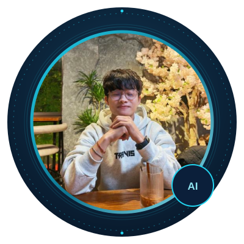

  <a href="README.md">English</a> · <a href="README.vi.md">Tiếng Việt</a> · <b>日本語</b>

  

  
  
  

 

<table>
<tr>
<td width="32%" align="center" valign="top">
  
    
  <b>Nguyễn Quang Duy</b> 
  AIアプリケーションエンジニア 
  ベトナム・ハノイ
    
  
</td>
<td width="68%" valign="top">
  <h3>はじめまして、Duyです。</h3>
  
ハノイ工科大学（ベトナム・日本プログラム）で情報技術を学び、現在は地方自治体・企業・小規模事業者向けに応用AIプロダクトを開発しています。要件定義、データ、モデル、本番運用まで一貫して担当します。

  
良いAIプロダクトには <b>実データで答えられること</b>、<b>個人データを犠牲にしないこと</b>、<b>デモの外で動くこと</b> が必要だと考えています。そのため、ツール呼び出し、RAG、OCR/STT、セルフホスト型AIゲートウェイ、データ検証層を中心に開発しています。

  

    <b>開発中</b> · Làng Số — 村・街区のデジタル行政基盤 
    <b>注力</b> · ツール呼び出し · RAG · OCR/STT · PIIガードレール 
    <b>学習中</b> · SFIA基準のAIエンジニアリング 
    <b>希望職種</b> · AI Applications / AI Engineer
  

</td>
</tr>
</table>

## 01 — 現在開発中のもの

<table>
<tr>
<td width="50%" valign="top">
  <b><a href="https://xuantrach.langso.vn">Làng Số — スマートビレッジ</a></b> 
  村・街区向けデジタル行政基盤：世帯・住民、デジタル地図、多チャネル通知、アンケート、AIアシスタント。Xuân Trạchで412世帯・1,586人を対象に実証実験。 
  <code>FastAPI</code> <code>PostgreSQL</code> <code>pgvector</code> <code>React</code> <code>Docker</code>
</td>
<td width="50%" valign="top">
  <b>Digitization Hub</b> 
  音声・画像・動画のデジタル化システム：ベトナム語STT、OCR、Zaloチャット画像処理、全文検索、エクスポート。複数AIプロバイダーとクォータ管理。 
  <code>faster-whisper</code> <code>PaddleOCR</code> <code>VietOCR</code> <code>Laravel</code>
</td>
</tr>
</table>

## 02 — 主なプロジェクト

<table>
<tr>
<td width="50%" valign="top">
  
  <b>Làng Số — スマートビレッジ</b> 
  自治体向け11モジュール。AIによる通知作成、アンケート生成、根拠付きセマンティック検索、ロールベース制御とRow-Level Security。 
  <code>FastAPI</code> <code>PostGIS</code> <code>React 19</code>
</td>
<td width="50%" valign="top">
  
  <b>Digitization Hub</b> 
  マルチメディア資料のデジタル化：音声抽出、ベトナム語STT、OCR、Zaloチャット画像処理、全文検索。コレクション単位のRBACと資産ライフサイクル管理。 
  <code>Python</code> <code>Whisper</code> <code>OCR</code> <code>Laravel</code>
</td>
</tr>
<tr>
<td width="50%" valign="top">
  
  <b>Gia phả Auto — ハノイ工科大学 卒業論文</b> 
  家系図を関係グラフとしてモデル化し、ルールベースNLGで略歴を生成。SVG家系図と8ステップのWord/PDF書籍パイプライン。 
  <code>Python</code> <code>FastAPI</code> <code>Laravel</code> <code>SVG</code>
</td>
<td width="50%" valign="top">
  
  <b>自治体データ — ベトナム</b> 
  34省・3,321行政区のデータを収集。決定論的ルールとLLM抽出を組み合わせ、行政コード、座標、引用を検証して納品。 
  <code>Python</code> <code>Ollama</code> <code>SQLite</code>
</td>
</tr>
<tr>
<td width="50%" valign="top">
  
  <b>POS Shop SaaS</b> 
  マルチストアPOS・在庫管理SaaS：マルチテナント、7ロール、サーバー側での原価非表示、VietQR、プロモーション、単位換算。 
  <code>Node.js</code> <code>SQLite</code> <code>VietQR</code>
</td>
<td width="50%" valign="top">
  
  <b>AI Video Studio</b> 
  記事・テキストから9:16ショート動画を生成：台本、ベトナム語ローカルTTS、HyperFrames/Remotion + GSAPで構成。 
  <code>TypeScript</code> <code>TTS</code> <code>Remotion</code>
</td>
</tr>
</table>

## 03 — 技術スタック

  

 

<table>
<tr>
<td width="25%" valign="top">
  <b>AI / LLM</b> 
  ツール呼び出し・関数呼び出し RAG · pgvector · bge-m3 Ollama · セルフホストLLM PaddleOCR · Whisper マルチプロバイダー PIIガードレール
</td>
<td width="25%" valign="top">
  <b>バックエンド</b> 
  Python · FastAPI PHP · Laravel Node.js PostgreSQL · PostGIS Redis · Celery/ARQ Docker Compose · CI
</td>
<td width="25%" valign="top">
  <b>フロントエンド</b> 
  React 19 · TypeScript Vue 3 · Inertia Tailwind CSS shadcn/ui Vite レスポンシブ対応
</td>
<td width="25%" valign="top">
  <b>データ・運用</b> 
  pandas · SQL クローリング データ検証パイプライン GitHub Actions Linux · Nginx · Caddy ログ・評価
</td>
</tr>
</table>

## 04 — 仕事の原則

<table>
<tr>
<td width="33%" valign="top">
  <b>01 · 数値は検証可能であること</b> 
  モデルにSQLを書かせず、数値を作らせない。AIはツールを選び、APIが実データを検索し、根拠を返します。
</td>
<td width="33%" valign="top">
  <b>02 · 個人データを犠牲にしない</b> 
  セルフホストを優先し、クラウドモデルへのPII送信を遮断。機密データにはロールベース制御とRow-Level Securityを適用します。
</td>
<td width="33%" valign="top">
  <b>03 · 本番で動いてこそ価値</b> 
  仕様策定からデプロイ、実ユーザー、運用、計測まで。プロトタイプはゴールではなくスタートです。
</td>
</tr>
</table>

## 05 — コンタクト

  
  
  

 

  ハノイより、心を込めて · 2026

