  

  
  
  

 

<table>
<tr>
<td width="32%" align="center" valign="top">
  
    
  <b>Nguyễn Quang Duy</b> 
  AI Applications Engineer 
  Hà Nội, Việt Nam
    
  
</td>
<td width="68%" valign="top">
  <h3>Xin chào, mình là Duy.</h3>
  
Kỹ sư Công nghệ thông tin (Đại học Bách khoa Hà Nội, chương trình Việt–Nhật). Mình xây dựng sản phẩm AI ứng dụng cho chính quyền cơ sở, doanh nghiệp và hộ kinh doanh — từ đặc tả, dữ liệu, mô hình đến triển khai vận hành.

  
Mình tin một sản phẩm AI tốt phải <b>trả lời được số liệu thật</b>, <b>không đánh đổi dữ liệu cá nhân</b> và <b>chạy được ngoài môi trường demo</b>. Vì vậy phần lớn thời gian mình làm việc với tool-calling, RAG, OCR/STT, AI gateway tự host và các lớp kiểm chứng dữ liệu.

  

    <b>Đang xây</b> · Làng Số — nền tảng quản trị số cho thôn/tổ dân phố 
    <b>Tập trung</b> · Tool-calling · RAG · OCR/STT · PII guardrails 
    <b>Đang học</b> · AI Engineering theo chuẩn SFIA 
    <b>Mở cho</b> · AI Applications / AI Engineer
  

</td>
</tr>
</table>

## 01 — Điều mình đang xây

<table>
<tr>
<td width="50%" valign="top">
  <b><a href="https://xuantrach.langso.vn">Làng Số — Thôn Thông Minh</a></b> 
  Nền tảng quản trị số cho thôn/tổ dân phố: hộ &amp; nhân khẩu, bản đồ số, thông báo đa kênh, khảo sát, trợ lý AI. Thí điểm tại Thôn Xuân Trạch với 412 hộ / 1.586 nhân khẩu. 
  <code>FastAPI</code> <code>PostgreSQL</code> <code>pgvector</code> <code>React</code> <code>Docker</code>
</td>
<td width="50%" valign="top">
  <b>Digitization Hub</b> 
  Hệ thống số hóa tư liệu audio/ảnh/video: STT tiếng Việt, OCR, xử lý ảnh chat Zalo, tìm kiếm toàn văn và xuất dữ liệu. Quản lý nhiều provider AI và hạn mức. 
  <code>faster-whisper</code> <code>PaddleOCR</code> <code>VietOCR</code> <code>Laravel</code>
</td>
</tr>
</table>

## 02 — Dự án tiêu biểu

<table>
<tr>
<td width="50%" valign="top">
  
  <b>Làng Số — Thôn Thông Minh</b> 
  11 mô-đun cho chính quyền cơ sở. AI soạn thông báo, tạo khảo sát, tìm kiếm ngữ nghĩa có trích dẫn nguồn; phân quyền theo xóm và Row-Level Security. 
  <code>FastAPI</code> <code>PostGIS</code> <code>React 19</code>
</td>
<td width="50%" valign="top">
  
  <b>Digitization Hub</b> 
  Pipeline số hóa đa phương tiện: tách audio, STT tiếng Việt, OCR, xử lý ảnh chat Zalo, tìm kiếm toàn văn. RBAC theo bộ sưu tập và nhật ký vòng đời tư liệu. 
  <code>Python</code> <code>Whisper</code> <code>OCR</code> <code>Laravel</code>
</td>
</tr>
<tr>
<td width="50%" valign="top">
  
  <b>Gia phả Auto — ĐATN HUST</b> 
  Mô hình hóa phả hệ bằng đồ thị quan hệ, rule-based NLG sinh tiểu sử, dựng phả đồ SVG và pipeline 8 bước xuất sách Word/PDF. 
  <code>Python</code> <code>FastAPI</code> <code>Laravel</code> <code>SVG</code>
</td>
<td width="50%" valign="top">
  
  <b>Khai thác dữ liệu Xã Phường</b> 
  Thu thập 34 tỉnh/thành và 3.321 xã/phường; kết hợp quy tắc tất định với LLM trích xuất, kiểm chứng mã ĐVHC, tọa độ và trích dẫn trước khi bàn giao. 
  <code>Python</code> <code>Ollama</code> <code>SQLite</code>
</td>
</tr>
<tr>
<td width="50%" valign="top">
  
  <b>POS Shop SaaS</b> 
  Phần mềm bán hàng &amp; quản lý kho đa cửa hàng: kiến trúc đa tenant, 7 vai trò, ẩn giá vốn phía server, VietQR, khuyến mãi và quy đổi đơn vị. 
  <code>Node.js</code> <code>SQLite</code> <code>VietQR</code>
</td>
<td width="50%" valign="top">
  
  <b>AI Video Studio</b> 
  Pipeline tạo video ngắn 9:16 từ bài báo/văn bản: kịch bản, TTS tiếng Việt local, dựng hình bằng HyperFrames/Remotion + GSAP. 
  <code>TypeScript</code> <code>TTS</code> <code>Remotion</code>
</td>
</tr>
</table>

## 03 — Tech stack

  

 

<table>
<tr>
<td width="25%" valign="top">
  <b>AI / LLM</b> 
  Tool-calling &amp; function calling RAG · pgvector · bge-m3 Ollama · self-host LLM PaddleOCR · Whisper Multi-provider gateway PII guardrails
</td>
<td width="25%" valign="top">
  <b>Backend</b> 
  Python · FastAPI PHP · Laravel Node.js PostgreSQL · PostGIS Redis · Celery/ARQ Docker Compose · CI
</td>
<td width="25%" valign="top">
  <b>Frontend</b> 
  React 19 · TypeScript Vue 3 · Inertia Tailwind CSS shadcn/ui Vite Responsive &amp; accessible
</td>
<td width="25%" valign="top">
  <b>Dữ liệu &amp; vận hành</b> 
  pandas · SQL Crawling / scraping Pipeline kiểm chứng GitHub Actions Linux · Nginx · Caddy Logging &amp; đánh giá
</td>
</tr>
</table>

## 04 — Cách mình làm việc

<table>
<tr>
<td width="33%" valign="top">
  <b>01 · Số liệu phải truy vết được</b> 
  Mô hình không tự viết SQL hay bịa con số. AI chọn công cụ, API truy vấn dữ liệu thật và trả về nguồn để kiểm chứng.
</td>
<td width="33%" valign="top">
  <b>02 · Không đánh đổi dữ liệu cá nhân</b> 
  Ưu tiên self-host, chặn PII ra mô hình mây, phân quyền theo vai trò và Row-Level Security cho dữ liệu nhạy cảm.
</td>
<td width="33%" valign="top">
  <b>03 · Chạy thật mới tính</b> 
  Từ đặc tả đến triển khai, có người dùng, có vận hành và có đo lường. Prototype chỉ là bước đầu, không phải đích.
</td>
</tr>
</table>

## 05 — Kết nối

  
  
  

 

  Built with care in Hà Nội · 2026

