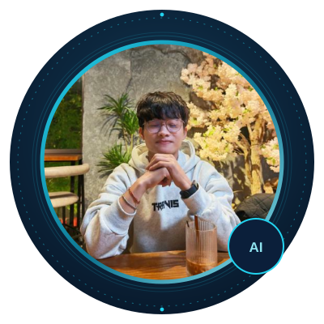

  <b>English</b> · <a href="README.vi.md">Tiếng Việt</a> · <a href="README.ja.md">日本語</a>

  

  
  
  

 

<table>
<tr>
<td width="32%" align="center" valign="top">
  
    
  <b>Nguyễn Quang Duy</b> 
  AI Applications Engineer 
  Hanoi, Vietnam
    
  
</td>
<td width="68%" valign="top">
  <h3>Hi, I'm Duy.</h3>
  
Information Technology engineer (Hanoi University of Science and Technology, Vietnam–Japan program). I build applied AI products for local governments, businesses, and small retailers — from requirements and data to models and production operations.

  
I believe a good AI product must <b>answer with real data</b>, <b>never trade away personal data</b>, and <b>run outside a demo</b>. That is why I spend most of my time with tool-calling, RAG, OCR/STT, self-hosted AI gateways, and data verification layers.

  

    <b>Building</b> · Làng Số — digital governance platform for villages 
    <b>Focus</b> · Tool-calling · RAG · OCR/STT · PII guardrails 
    <b>Learning</b> · AI Engineering (SFIA) 
    <b>Open to</b> · AI Applications / AI Engineer
  

</td>
</tr>
</table>

## 01 — What I'm building

<table>
<tr>
<td width="50%" valign="top">
  <b><a href="https://langso.xaphuongvietnam.vn">Làng Số — Smart Village</a></b> 
  Digital governance platform for villages: households &amp; residents, digital map, multi-channel announcements, surveys, AI assistant. Piloted in Xuân Trạch with 412 households / 1,586 residents. 
  <code>FastAPI</code> <code>PostgreSQL</code> <code>pgvector</code> <code>React</code> <code>Docker</code>
</td>
<td width="50%" valign="top">
  <b>Digitization Hub</b> 
  Audio/image/video digitization system: Vietnamese STT, OCR, Zalo chat image processing, full-text search and exports. Multi-provider AI with quota management. 
  <code>faster-whisper</code> <code>PaddleOCR</code> <code>VietOCR</code> <code>Laravel</code>
</td>
</tr>
</table>

## 02 — Selected work

<table>
<tr>
<td width="50%" valign="top">
  
  <b><a href="https://langso.xaphuongvietnam.vn">Làng Số — Smart Village</a></b> 
  11 modules for local government. AI drafts announcements, generates surveys, and answers with cited semantic search; role-based access and Row-Level Security. 
  <code>FastAPI</code> <code>PostGIS</code> <code>React 19</code>
</td>
<td width="50%" valign="top">
  
  <b>Digitization Hub</b> 
  Multimedia digitization pipeline: audio extraction, Vietnamese STT, OCR, Zalo chat image processing, full-text search. Collection-level RBAC and asset lifecycle logs. 
  <code>Python</code> <code>Whisper</code> <code>OCR</code> <code>Laravel</code>
</td>
</tr>
<tr>
<td width="50%" valign="top">
  
  <b>Gia phả Auto — HUST thesis</b> 
  Genealogy modeled as a relational graph, rule-based NLG for biographies, SVG family trees, and an 8-step Word/PDF book pipeline. 
  <code>Python</code> <code>FastAPI</code> <code>Laravel</code> <code>SVG</code>
</td>
<td width="50%" valign="top">
  
  <b><a href="https://github.com/duynq15/khai-thac-du-lieu">Commune Data — Vietnam</a></b> 
  Collected 34 provinces and 3,321 communes; combined deterministic rules with LLM extraction; verified administrative codes, coordinates and citations before handover. 
  <code>Python</code> <code>Ollama</code> <code>SQLite</code>
</td>
</tr>
<tr>
<td width="50%" valign="top">
  
  <b><a href="https://github.com/duynq15/pos-shop-saas">POS Shop SaaS</a></b> 
  Multi-store POS &amp; inventory SaaS: multi-tenant architecture, 7 roles, server-side cost hiding, VietQR, promotions and unit conversion. 
  <code>Node.js</code> <code>SQLite</code> <code>VietQR</code>
</td>
<td width="50%" valign="top">
  
  <b><a href="https://github.com/duynq15/ai-video-studio">AI Video Studio</a></b> 
  9:16 short-video pipeline from articles/text: script, local Vietnamese TTS, composition with HyperFrames/Remotion + GSAP. 
  <code>TypeScript</code> <code>TTS</code> <code>Remotion</code>
</td>
</tr>
</table>

## 03 — Tech stack

  

 

<table>
<tr>
<td width="25%" valign="top">
  <b>AI / LLM</b> 
  Tool-calling &amp; function calling RAG · pgvector · bge-m3 Ollama · self-host LLM PaddleOCR · Whisper Multi-provider gateway PII guardrails
</td>
<td width="25%" valign="top">
  <b>Backend</b> 
  Python · FastAPI PHP · Laravel Node.js PostgreSQL · PostGIS Redis · Celery/ARQ Docker Compose · CI
</td>
<td width="25%" valign="top">
  <b>Frontend</b> 
  React 19 · TypeScript Vue 3 · Inertia Tailwind CSS shadcn/ui Vite Responsive &amp; accessible
</td>
<td width="25%" valign="top">
  <b>Data &amp; Ops</b> 
  pandas · SQL Crawling / scraping Verification pipelines GitHub Actions Linux · Nginx · Caddy Logging &amp; evaluation
</td>
</tr>
</table>

## 04 — How I work

<table>
<tr>
<td width="33%" valign="top">
  <b>01 · Numbers must be traceable</b> 
  The model never writes SQL or invents numbers. AI selects a tool, the API queries real data, and every answer links back to a source.
</td>
<td width="33%" valign="top">
  <b>02 · Never trade personal data</b> 
  Self-hosting first, PII blocked from cloud models, role-based access and Row-Level Security for sensitive data.
</td>
<td width="33%" valign="top">
  <b>03 · Production is the bar</b> 
  From specification to deployment, with real users, operations, and measurement. A prototype is the start, not the finish line.
</td>
</tr>
</table>

## 05 — Connect

  
  
  

 

  Built with care in Hanoi · 2026

